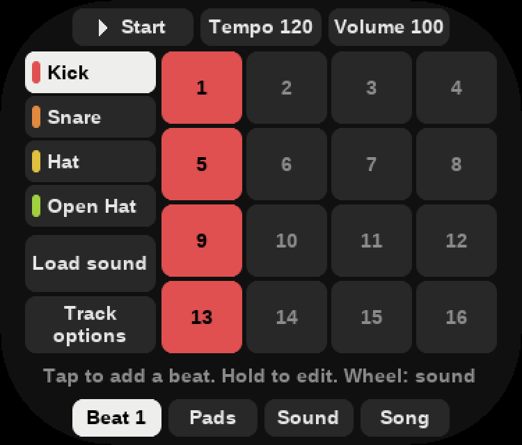

# Groovebox

A groovebox for the Shanling Q2, as a card app: sixteen pads, each a sample, a synth or a live
909, 808, 303 or break; a step sequencer with parameter locks, ratchets, chance and songs;
punch-in effects, echo and reverb; and the DAC you already carry.

The [mini-guide](https://github.com/DiamondBond/q2-groovebox/raw/main/docs/guide/Groovebox-Mini-Guide.pdf)
(PDF) shows how to use it, and how to make your own drum kit.

It needs Q2 Pod 1.7.2 or later for its sound and media keys. Unzip `groovebox.zip` to the card's
root (it holds one folder, `.groovebox`). It then appears under Games and as the **Groovebox**
choice of the Shortcut setting.

Sound goes to whatever Q2 Pod is playing through: the headphone jack, Bluetooth or a USB DAC. On
USB it opens the first USB-Audio card at 44.1 kHz 16-bit. The volume starts where Q2 Pod's was.

## Making a beat

Open it and press **Start**: a plain beat is already there. Tap the numbered boxes to add or remove
hits, and turn the wheel to move to another sound. That is all you need to begin.

The line above the tabs always says what the keys do on that screen. A value is always a labelled
box: tap it, then turn the wheel. Tempo and Volume work the same way: tap one and it lights, the
wheel changes it, and tapping anything else hands the wheel back.

| Key | Does |
| --- | --- |
| Play/Pause | Start and stop |
| Wheel | What the line above the tabs says: the sound on Beat, the lit box on a page of boxes |
| Centre | Hear the sound; in Load, pick the row |
| Return | Back; where there is nothing to go back to, undo |
| Return, held | Quit |
| Prev / Next | Sound: the previous or next sound. Beat, on a long track: the page of steps. Otherwise the previous or next beat |

### Beat

The list is your sixteen sounds, and the boxes are the steps of the one that is lit. A row of four
is one beat. A coloured bar in the list means that sound has steps. **Load sound** gives the lit
sound a new one.

Hold a step to open it: its note, volume, decay and filter, **Roll** (how many hits in the step),
**Chance**, **Accent**, **Slide** and **Nudge**. **Remove step** takes it off, and **Done** or Return
comes back.

**Options** has **Steps** (up to 64; arrows appear beside the hint for the pages), **Speed**
(1/32 to 1/4, with triplets), **Clear steps** and **Undo**. On a synth or the 303, **Make tune**
writes a line in the song's key and scale, **Vary tune** changes a few of its steps, and **Busy**
sets how many notes it uses. Tracks of different lengths and speeds drift against each other, and a
beat plays until its longest track ends.

### Pads

**Drums** plays the sixteen sounds; the wheel is a filter sweep. **Notes** plays the lit sound up
the song's scale, or a drum loop's slices and tricks; the wheel changes the sound. **Effects** are
twenty-seven punch-in effects, time-synced to the tempo, on two pages: hold a pad to hear one.
**Record** starts the beat if it is stopped and writes what you play onto the steps, quantised,
effects included. Record again or Stop ends the take, and Return undoes it. On Effects, with no take
to undo, Return clears the beat's effects.

### Sound

The lit sound's controls. **More** turns the page. A synth starts with its **Preset**, so the wheel
walks through them; the 909, 808, 303 and drum loops show their own controls after Volume, Pitch,
Echo, Reverb and Pan. Centre plays the sound, so you can hear each change.

### Load sound

Wheel and Centre, or tap a row; **Back** or Return goes up one.

- **Drum kits** replace all sixteen sounds and keep your steps. **Default**, **909**, **808** and
  **Melodic** are samples, **909 Live** and **808 Live** the machines. A kit is a folder
  `.groovebox/kits/<name>/` of WAVs named `NN Name.wav`.
- **Single drums**: any of the sixteen sounds of the 909 or 808, modelled as it plays.
- **Synths**: the engines Analog, Lofi, Trio, Wheel, Noise and Phase, and their presets. The list
  stays open and plays each one you pick, so you can try the next.
- **303 bass**: an acid voice with slide and accent.
- **Drum loops**: a loop cut into eight slices and rearranged as it plays, in time with the tempo:
  a built-in groove or fill, or the sound's own sample.
- **Music on the card**: any audio file the Q2 plays. Use it on the lit sound, from the start or
  from one of the later start points, twenty seconds at most; slice it across all sixteen sounds,
  at its hits or evenly; or use it as a drum loop. Trim with Start and End. Loaded sounds are kept
  with the project, and a kit change clears them.
- **From your phone** shows an address. With the Q2 and the phone on the same Wi-Fi (the phone's
  own hotspot works), open it in the phone's browser and choose a recording, up to 64 MB. It is
  saved to `Music/Groovebox/Drops`, and the Q2 goes straight to the choices above. The page exists
  only while that screen is open, under the code in its address.

### Song

The boxes are your sixteen beats: tap one to play it, at the end of the one playing. The wheel is
the tempo.

**Add to song** puts the beat on the end of the list shown above the tabs, and **Remove last** takes
one off. With two or more the beats play in turn and loop. **Copy beat** copies this one to the next
empty beat and goes there.

**Save WAV** renders the beat, or the whole song, to `Music/Groovebox/1-<n>.wav`, 44.1 kHz 16-bit
stereo, without the volume or the sweep. It plays in the player and survives Remove; load it back
from **Music on the card** to resample.

**Settings** has the song's swing, key and scale, and the effects on the mix: distortion, drive and
compression, and the echo and reverb that the sounds' Echo and Reverb send to.

Projects live in `.groovebox/projects/` on the card, saved two seconds after a change and on the way
out. They survive an update; Remove deletes them.

Left stopped and untouched for five minutes, Groovebox quits. If its screen stops answering for eight
seconds it writes what each thread was doing to `.groovebox/freeze.txt`, and ends itself unless the
screen comes back within two more.

## Building

The device binary links the Q2's own glibc 2.28, libm, libpthread and libasound through a sysroot
made by Rockbox's `tools/shanlingq2/mksysroot.sh` from the stock firmware zip; `make
SYSROOT=path` builds `dist/.groovebox/` and `dist/groovebox.zip`. `make host` builds an SDL2
window (mouse = finger, scroll = wheel, Enter = Centre, Backspace = Return, Space = Play, `[` `]` =
Prev/Next), and `--script FILE OUTDIR` replays input lines and writes frames (`tests/beat.txt` walks
every mode; `GROOVEBOX_MEDIA` is the folder Load browses). `make check` runs the asserts, and
requires the lifted effects to match SLOOP's own output. `tools/upstream.sh` regenerates what comes
from upstream at the pinned commits: the tables, those hashes and the kits. `docs/guide/build.py`
rebuilds the mini-guide's PDF (needs Chromium and `pdftotext`); its screens are frames from
`tests/beat.txt`.

## Credits

See [CREDITS.md](CREDITS.md). GPL-3.0-only.
